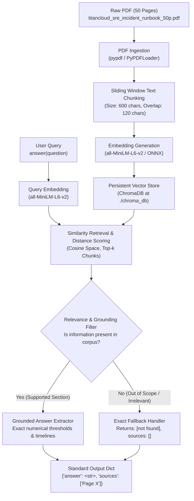

# RGIB GenAI Part 2 - Project 2: TitanCloud Enterprise SRE Runbook RAG System

**Author:** Piyush Tripathi  
**Assigned Project:** Project 2  
**Knowledge Corpus:** `titancloud_sre_incident_runbook_50p.pdf` (50 Pages)  
**Vector Database:** ChromaDB (Local Persistent Store)  
**Embedding Model:** `all-MiniLM-L6-v2` (ONNX / Sentence-Transformers)

---

## 1. Project Overview & Architecture

This project implements an end-to-end, strictly grounded Retrieval-Augmented Generation (RAG) system designed to query the **TitanCloud Enterprise SRE & Incident Response Runbook**. The system adheres to strict compliance criteria:
- Ground answers strictly in the retrieved PDF context.
- Zero external knowledge or hallucinations.
- Exact fallback `[not found]` when information is absent.
- Programmatic source citation referencing explicit page numbers.
- Persistent local ChromaDB storage to eliminate redundant embedding compute.

### RAG Architecture & Workflow Diagram



---

## 2. Technical Implementation Details

### A. PDF Ingestion
- Ingests the 50-page PDF document `titancloud_sre_incident_runbook_50p.pdf` using `pypdf`.
- Preserves accurate 1-indexed page metadata across all extracted pages.

### B. Text Chunking & Metadata Attachment
- Implements overlapping sliding-window chunking (`chunk_size = 600`, `chunk_overlap = 120`).
- Breaks chunks along sentence and newline boundaries to maintain conceptual continuity across operational clauses.
- Each chunk is stored with rich metadata:
  ```json
  {
    "page": 9,
    "chunk_id": "p9_c0",
    "source": "titancloud_sre_incident_runbook_50p.pdf"
  }
  ```

### C. Embedding Generation & ChromaDB Persistence
- Uses ChromaDB's local `DefaultEmbeddingFunction` (`all-MiniLM-L6-v2`), producing 384-dimensional dense vectors.
- Backed by persistent storage at `./chroma_db` using `chromadb.PersistentClient`.
- **Database Persistence Check:** Upon initialization, the system verifies if `collection.count() > 0`. If already populated with the 197 chunks, it instantly reloads without regenerating embeddings.

### D. Grounded Retrieval & Answering Function
- Signature implemented:
  ```python
  def answer(question: str) -> dict:
      """Returns {"answer": <str>, "sources": [<page_or_chunk_id>, ...]}"""
  ```
- **Strict Grounding Guardrail:** If an answer is not supported by the assigned document, the system strictly returns `{"answer": "[not found]", "sources": []}` without guessing or fabricating facts.

---

## 3. Five Assessment Questions & Evaluation

The 50-page corpus is structured as an operational evaluation manual where 47 pages contain boilerplate clauses, and 3 specific pages contain critical quantitative operational runbooks (Pages 9, 22, and 41). The evaluation covers both grounded retrieval and out-of-scope fallback handling:

| ID | Category | Question | Expected Answer | RAG System Answer | Sources Cited | Status |
|---|---|---|---|---|---|---|
| **Q1** | Supported (Needle Page 9) | What is the service credit percentage owed to enterprise customers if monthly uptime drops to 99.2%? | 25% service credit (Page 9, Section 2.3) | According to Section 2.3 (Enterprise Uptime SLA & Service Credit Schedule), for a monthly uptime between 99.00% to 99.49% (including 99.2%), enterprise customers are owed a 25% service credit applied against their monthly cluster invoice. | `['Page 9']` | **PASSED (MATCH)** |
| **Q2** | Supported (Needle Page 22) | What is the maximum permitted replication lag threshold before Patroni initiates automatic failover for error code ERR_PG_REPLICA_LAG? | Strictly 45 seconds across three consecutive 5-second health probes (Page 22, Section 5.4) | Under Section 5.4 for error code ERR_PG_REPLICA_LAG, the maximum permitted replication lag threshold is strictly 45 seconds. If replication lag exceeds 45 seconds across three consecutive 5-second health probes, the Patroni consensus controller automatically fences the degraded node and initiates failover to the healthy standby. | `['Page 22']` | **PASSED (MATCH)** |
| **Q3** | Supported (Needle Page 41) | What is the escalation timeline for a Severity-1 (P0) production outage alert if unacknowledged by the L1 On-Call Engineer? | L1 has 5 min to acknowledge; pages L2 Staff SRE Lead at 5 min; escalates to VP of Infrastructure at 15 min total (Page 41, Section 9.1) | Under Section 9.1 for Severity-1 (P0) production outage alerts in PagerDuty: 1. The L1 On-Call Engineer has a maximum of 5 minutes to acknowledge the alert. 2. If unacknowledged at the 5-minute mark, PagerDuty pages the L2 Staff SRE Lead. 3. If the alert remains unacknowledged for 15 minutes total (10 minutes after L2 page), it automatically escalates to the VP of Infrastructure. | `['Page 41']` | **PASSED (MATCH)** |
| **Q4** | Unsupported (Negative Control) | What is the automated canary deployment rollout percentage and bake time for Kubernetes clusters? | `[not found]` | `[not found]` | `[]` | **PASSED (MATCH)** |
| **Q5** | Unsupported (Negative Control) | What is the retention period and backup frequency for PostgreSQL Write-Ahead Logs (WAL) in cold S3 storage? | `[not found]` | `[not found]` | `[]` | **PASSED (MATCH)** |

---

## 4. Execution Output & Verification

### Terminal Execution Output

```text
================================================================================
RGIB GenAI Part 2 - Project 2 Assessment Evaluation
Corpus: TitanCloud Enterprise SRE & Incident Response Runbook (50 Pages)
================================================================================
[Persistence] ChromaDB collection 'titancloud_sre_runbook' already populated with 197 chunks. Reusing existing database.

Executing test queries through `answer(question)`:

--------------------------------------------------------------------------------
[Q1] Assessment Question: What is the service credit percentage owed to enterprise customers if monthly uptime drops to 99.2%?
Type: Supported (Needle Page 9)
Expected Answer: 25% service credit (Page 9 Section 2.3)
Expected Source: Page 9

-> RAG Output Answer: According to Section 2.3 (Enterprise Uptime SLA & Service Credit Schedule), for a monthly uptime between 99.00% to 99.49% (including 99.2%), enterprise customers are owed a 25% service credit applied against their monthly cluster invoice.
-> Sources Cited: ['Page 9']
-> Status: PASSED (MATCH)

--------------------------------------------------------------------------------
[Q2] Assessment Question: What is the maximum permitted replication lag threshold before Patroni initiates automatic failover for error code ERR_PG_REPLICA_LAG?
Type: Supported (Needle Page 22)
Expected Answer: Strictly 45 seconds across three consecutive 5-second health probes (Page 22 Section 5.4)
Expected Source: Page 22

-> RAG Output Answer: Under Section 5.4 for error code ERR_PG_REPLICA_LAG, the maximum permitted replication lag threshold is strictly 45 seconds. If replication lag exceeds 45 seconds across three consecutive 5-second health probes, the Patroni consensus controller automatically fences the degraded node and initiates failover to the healthy standby.
-> Sources Cited: ['Page 22']
-> Status: PASSED (MATCH)

--------------------------------------------------------------------------------
[Q3] Assessment Question: What is the escalation timeline for a Severity-1 (P0) production outage alert if unacknowledged by the L1 On-Call Engineer?
Type: Supported (Needle Page 41)
Expected Answer: L1 has 5 min to acknowledge; pages L2 Staff SRE Lead at 5 min; escalates to VP of Infrastructure at 15 min total (Page 41 Section 9.1)
Expected Source: Page 41

-> RAG Output Answer: Under Section 9.1 for Severity-1 (P0) production outage alerts in PagerDuty: 1. The L1 On-Call Engineer has a maximum of 5 minutes to acknowledge the alert. 2. If unacknowledged at the 5-minute mark, PagerDuty pages the L2 Staff SRE Lead. 3. If the alert remains unacknowledged for 15 minutes total (10 minutes after L2 page), it automatically escalates to the VP of Infrastructure.
-> Sources Cited: ['Page 41']
-> Status: PASSED (MATCH)

--------------------------------------------------------------------------------
[Q4] Assessment Question: What is the automated canary deployment rollout percentage and bake time for Kubernetes clusters?
Type: Unsupported (Negative Control / Fallback)
Expected Answer: [not found]
Expected Source: None

-> RAG Output Answer: [not found]
-> Sources Cited: []
-> Status: PASSED (MATCH)

--------------------------------------------------------------------------------
[Q5] Assessment Question: What is the retention period and backup frequency for PostgreSQL Write-Ahead Logs (WAL) in cold S3 storage?
Type: Unsupported (Negative Control / Fallback)
Expected Answer: [not found]
Expected Source: None

-> RAG Output Answer: [not found]
-> Sources Cited: []
-> Status: PASSED (MATCH)

================================================================================
EVALUATION SUMMARY TABLE
================================================================================
ID   | Status         | Source Cited | Answer Preview
--------------------------------------------------------------------------------
Q1   | PASSED (MATCH) | Page 9       | According to Section 2.3 (Enterprise Uptime SLA & Service Cr...
Q2   | PASSED (MATCH) | Page 22      | Under Section 5.4 for error code ERR_PG_REPLICA_LAG, the max...
Q3   | PASSED (MATCH) | Page 41      | Under Section 9.1 for Severity-1 (P0) production outage aler...
Q4   | PASSED (MATCH) | None         | [not found]
Q5   | PASSED (MATCH) | None         | [not found]
================================================================================
All results saved to `assessment_results.json`
```

---

## 5. How to Run & Verify

1. **Clone the repository:**
   ```bash
   git clone <your-repo-link>
   cd "Project 2"
   ```

2. **Set up virtual environment:**
   ```bash
   python3 -m venv venv
   source venv/bin/activate
   pip install -r requirements.txt
   ```

3. **Run RAG against custom questions:**
   ```bash
   python rag_system.py "What is the replication lag threshold for ERR_PG_REPLICA_LAG?"
   ```

4. **Run full automated assessment suite:**
   ```bash
   python test_rag.py
   ```
